# Examen práctico DevOps: AWS CI/CD

- Servicios: `app-ecs` (catálogo) y `app-lambda` (pedidos y reportes)
- Región: us-east-1 (N. Virginia)
- Entorno desplegado: QA (`APP_ENV=qa` en ECS y en Lambda)
- Punto de entrada: http://alb-examen-1242050974.us-east-1.elb.amazonaws.com
- Ramas: `Desarrollo`, `QA` y `main`
- Repositorio privado: `erickvb92/devops-aws`

Usé un monorepositorio en GitHub porque los dos servicios son parte del mismo ejercicio. Aun así, cada uno tiene su propio `buildspec.yml` y su propio pipeline, así que un cambio en ECS no obliga a desplegar Lambda y al revés.

Lo que entrego es un ambiente QA funcional. Desarrollé en la rama `Desarrollo` y configuré los pipelines para que solo se ejecuten cuando se integran cambios en `QA` mediante Pull Request.

## A. Arquitectura

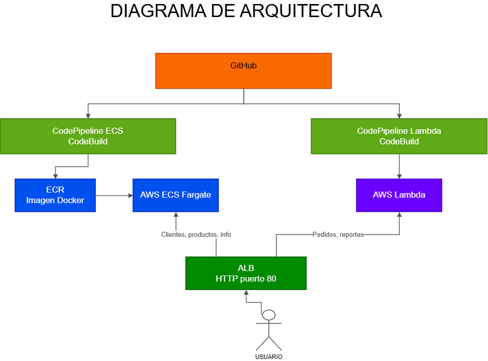

[Diagrama editable en Draw.io](docs/arquitectura/arquitectura-aws-qa.drawio)

El cliente entra por un Application Load Balancer (ALB), que revisa la ruta y manda la solicitud al servicio que corresponde:

- **ECS Fargate (`app-ecs`)** atiende clientes, productos, información y su propio `/health`. Corre en un contenedor Node.js en el puerto 3000 y la imagen está en ECR.
- **AWS Lambda (`app-lambda`)** atiende pedidos y reportes. También tiene `/health`; lo distingo del de ECS con el encabezado `Host: lambda.examen.local`.
- **CodePipeline** toma los cambios de GitHub, ejecuta **CodeBuild** y despliega. Son dos pipelines independientes: `pipeline-app-ecs` y `pipeline-app-lambda`.
- **CloudWatch Logs** guarda los registros del contenedor, de las compilaciones y del despliegue de Lambda. **S3** guarda los artefactos de CodePipeline.

## B. Comandos para comprobar la entrega

Trabajé con Windows PowerShell, AWS CLI, Docker, Git y GitHub. Todos los comandos de este documento son de PowerShell, no de Bash.

1. AWS CLI configurada con un usuario IAM que pueda crear los recursos de abajo.
2. Docker Desktop iniciado y Git instalado.
3. El repositorio de GitHub con las carpetas `app-ecs/` y `app-lambda/`, y acceso para autorizar la conexión de AWS con GitHub.
4. Una región con al menos dos subredes en zonas de disponibilidad distintas. Usé la VPC predeterminada.

Antes de empezar revisé las herramientas y la sesión:

```powershell
aws --version
docker --version
git --version
aws sts get-caller-identity
```

No puse claves de AWS en scripts, en este README ni en GitHub. Me autentiqué con `aws configure`.

Cloné el código y definí las variables que uso en todo el documento:

```powershell
cd $HOME
git clone https://github.com/erickvb92/devops-aws.git
cd .\devops-aws

$REGION = 'us-east-1'
$ACCOUNT = (aws sts get-caller-identity --query Account --output text).Trim()
$ECR = "$ACCOUNT.dkr.ecr.$REGION.amazonaws.com"
$BUCKET = "pipeline-artifacts-$ACCOUNT-$REGION"
$REPO_ID = 'erickvb92/devops-aws'

Write-Host "Cuenta: $ACCOUNT | Región: $REGION | ECR: $ECR"
```

Si cierras PowerShell hay que volver a definir las variables.

### Resultado de la conexión a AWS

Lo primero fue confirmar que estaba en la cuenta correcta y guardar el número de cuenta en `$ACCOUNT` para no escribirlo a mano en cada ARN.

**Comando que ejecuté:**

```powershell
aws sts get-caller-identity
$ACCOUNT = aws sts get-caller-identity --query Account --output text
$REGION = "us-east-1"
$ECR = "$ACCOUNT.dkr.ecr.$REGION.amazonaws.com"
echo $ECR
```

**Salida de mi consola (extracto, con el ID de cuenta ocultado):**

```text
PS C:\Users\ERICK> echo $ECR
<ID_CUENTA>.dkr.ecr.us-east-1.amazonaws.com
```

## 3. ECR y primera imagen Docker

Primero creé el repositorio donde se guarda la imagen de ECS. El `Dockerfile` está en `app-ecs/Dockerfile` y usa Node.js 24 desde Amazon ECR Public.

```powershell
aws ecr create-repository --repository-name app-ecs --region $REGION

aws ecr get-login-password --region $REGION |
  docker login --username AWS --password-stdin $ECR

docker build -t app-ecs:inicial .\app-ecs
docker tag app-ecs:inicial "${ECR}/app-ecs:inicial"
docker push "${ECR}/app-ecs:inicial"

aws ecr list-images --repository-name app-ecs --region $REGION
```

La primera imagen lleva la etiqueta `inicial`. Después CodeBuild crea las nuevas con los primeros siete caracteres del commit y también `latest`.

Esto es lo importante de `app-ecs/buildspec.yml`, que ya está en el repositorio:

```yaml
version: 0.2
phases:
  pre_build:
    commands:
      - aws ecr get-login-password --region $AWS_REGION | docker login --username AWS --password-stdin $ECR_URI
      - TAG=$(echo $CODEBUILD_RESOLVED_SOURCE_VERSION | cut -c1-7)
      - TAG=${TAG:-build-$CODEBUILD_BUILD_NUMBER}
  build:
    commands:
      - cd app-ecs
      - docker build -t $ECR_URI/app-ecs:$TAG -t $ECR_URI/app-ecs:latest .
  post_build:
    commands:
      - docker push $ECR_URI/app-ecs:$TAG
      - docker push $ECR_URI/app-ecs:latest
      - printf '[{"name":"app-ecs","imageUri":"%s"}]' $ECR_URI/app-ecs:$TAG > $CODEBUILD_SRC_DIR/imagedefinitions.json
artifacts:
  files:
    - imagedefinitions.json
```

`imagedefinitions.json` le dice a CodePipeline qué imagen poner en el servicio ECS. El nombre del contenedor (`app-ecs`) tiene que coincidir exactamente con el de la definición de tarea.

### Resultado al crear ECR y subir la imagen

Al crear el repositorio me salió un `AccessDeniedException`. Corregí los permisos IAM y repetí el mismo comando. Después hice login, build, tag y push, y el listado mostró la imagen inicial.

**Comando que ejecuté:**

```powershell
aws ecr create-repository --repository-name app-ecs --region $REGION
aws ecr list-images --repository-name app-ecs --region $REGION
```

**Salida de mi consola:**

```text
PS C:\Users\ERICK> aws ecr create-repository --repository-name app-ecs --region $REGION
aws: [ERROR]: An error occurred (AccessDeniedException) when calling the CreateRepository operation:
User: arn:aws:iam::<ID_CUENTA>:user/devops-erick is not authorized to perform: ecr:CreateRepository

PS C:\Users\ERICK> aws ecr create-repository --repository-name app-ecs --region $REGION
{
  "repository": {
    "repositoryArn": "arn:aws:ecr:us-east-1:<ID_CUENTA>:repository/app-ecs",
    "repositoryName": "app-ecs",
    "repositoryUri": "<ID_CUENTA>.dkr.ecr.us-east-1.amazonaws.com/app-ecs"
  }
}

PS C:\Users\ERICK> aws ecr list-images --repository-name app-ecs --region $REGION
{
  "imageIds": [
    { "imageTag": "inicial", "imageDigest": "sha256:948293a7eddb0091485d9fda32b04fc449553cef6f590eee407ee2ccf459c1dc" }
  ]
}
```

## 4. VPC, subredes y Security Groups

Usé la VPC predeterminada y dos de sus subredes. Los IDs cambian en cada cuenta, así que los consulto con comandos.

```powershell
$VPC = aws ec2 describe-vpcs `
  --filters Name=isDefault,Values=true `
  --query 'Vpcs[0].VpcId' --output text --region $REGION

$SUBNETS = @((aws ec2 describe-subnets `
  --filters Name=vpc-id,Values=$VPC `
  --query 'Subnets[*].SubnetId' --output text --region $REGION) -split '\s+' | Where-Object { $_ })

$S1 = $SUBNETS[0]
$S2 = $SUBNETS[1]

aws ec2 describe-subnets --subnet-ids $S1 $S2 `
  --query 'Subnets[*].[SubnetId,AvailabilityZone]' --output table --region $REGION
```

Revisé que `$S1` y `$S2` estuvieran en zonas de disponibilidad distintas, porque el ALB lo exige.

Creé dos grupos de seguridad separados para no exponer el contenedor directamente:

```powershell
$SG_ALB = aws ec2 create-security-group `
  --group-name alb-publico --description 'ALB publico' `
  --vpc-id $VPC --query GroupId --output text --region $REGION

aws ec2 authorize-security-group-ingress `
  --group-id $SG_ALB --protocol tcp --port 80 `
  --cidr 0.0.0.0/0 --region $REGION

$SG_ECS = aws ec2 create-security-group `
  --group-name ecs-tareas --description 'Tareas ECS' `
  --vpc-id $VPC --query GroupId --output text --region $REGION

aws ec2 authorize-security-group-ingress `
  --group-id $SG_ECS --protocol tcp --port 3000 `
  --source-group $SG_ALB --region $REGION
```

| Origen | Destino | Puerto | Motivo |
|---|---|---|---|
| Internet | ALB | TCP 80 | Entrada HTTP de los clientes |
| SG del ALB | ECS | TCP 3000 | Solo el balanceador entra al contenedor |
| Internet | ECS | n/a | Sin acceso directo al contenedor |
| Internet | ALB | TCP 443 | No lo configuré; HTTPS quedó como opcional |

El servicio ECS tiene IP pública para poder descargar la imagen y llegar a los servicios de AWS sin NAT. Eso no deja el puerto 3000 abierto a Internet, porque el Security Group solo acepta tráfico que venga del ALB. En producción usaría subredes privadas con NAT o VPC endpoints.

Para revisar los grupos creados:

```powershell
aws ec2 describe-security-groups --group-ids $SG_ALB $SG_ECS `
  --query 'SecurityGroups[*].[GroupName,GroupId]' --output table --region $REGION
```

### IDs de red y error al crear los SG

Consulté la VPC predeterminada y sus subredes. Al principio intenté llamar a los grupos `sg-alb` y `sg-ecs`, pero AWS no acepta nombres que empiecen con `sg-`. Los volví a crear como `alb-publico` y `ecs-tareas`.

**Comando que ejecuté:**

```powershell
echo $VPC $S1 $S2
echo $SG_ALB $SG_ECS
```

**Salida de mi consola:**

```text
PS C:\Users\ERICK> echo $VPC $S1 $S2
vpc-09a88bd6075cec292
subnet-08a447894c3cf212b
subnet-07fb5b96f54faa3b2

PS C:\Users\ERICK> aws ec2 create-security-group --group-name sg-alb --description "ALB publico" --vpc-id $VPC
aws: [ERROR]: An error occurred (InvalidParameterValue):
Value (sg-alb) for parameter GroupName is invalid. Group names may not be in the format sg-*.

PS C:\Users\ERICK> echo $SG_ALB $SG_ECS
sg-0cc2b0db586ea1183
sg-0f938e2ae480c2143
```

## 5. IAM, CloudWatch y clúster ECS

El contenedor necesita un rol de ejecución para bajar la imagen de ECR y escribir logs. Primero creé el grupo de logs en CloudWatch:

```powershell
aws logs create-log-group --log-group-name /ecs/app-ecs --region $REGION
```

Luego creé el rol `ecsTaskExecutionRole` con la política administrada de AWS para ECS:

```powershell
@'
{"Version":"2012-10-17","Statement":[{"Effect":"Allow","Principal":{"Service":"ecs-tasks.amazonaws.com"},"Action":"sts:AssumeRole"}]}
'@ | Set-Content -Encoding ascii trust-ecs.json

aws iam create-role --role-name ecsTaskExecutionRole `
  --assume-role-policy-document file://trust-ecs.json

aws iam attach-role-policy --role-name ecsTaskExecutionRole `
  --policy-arn arn:aws:iam::aws:policy/service-role/AmazonECSTaskExecutionRolePolicy

aws ecs create-cluster --cluster-name app-ecs-cluster --region $REGION
aws ecs describe-clusters --clusters app-ecs-cluster `
  --query 'clusters[0].status' --output text --region $REGION
```

El último comando tiene que devolver `ACTIVE`.

### Comprobación del clúster, IAM y CloudWatch

Antes de crear el clúster la consulta me devolvió `None` y el rol de ejecución tampoco existía. Después de crear todo, las tres comprobaciones salieron bien.

**Comando que ejecuté:**

```powershell
aws ecs describe-clusters --clusters app-ecs-cluster --query "clusters[0].status" --output text --region $REGION
aws iam get-role --role-name ecsTaskExecutionRole --query Role.Arn --output text
aws logs describe-log-groups --log-group-name-prefix /ecs/app-ecs --query "logGroups[0].logGroupName" --output text --region $REGION
```

**Salida de mi consola:**

```text
# Antes de crear los recursos:
PS C:\Users\ERICK> aws iam get-role --role-name ecsTaskExecutionRole --query Role.Arn --output text
aws: [ERROR]: An error occurred (NoSuchEntity) when calling the GetRole operation:
The role with name ecsTaskExecutionRole cannot be found.

# Después de crearlos:
PS C:\Users\ERICK> aws ecs describe-clusters --clusters app-ecs-cluster --query "clusters[0].status" --output text --region $REGION
ACTIVE
PS C:\Users\ERICK> aws iam get-role --role-name ecsTaskExecutionRole --query Role.Arn --output text
arn:aws:iam::<ID_CUENTA>:role/ecsTaskExecutionRole
PS C:\Users\ERICK> aws logs describe-log-groups --log-group-name-prefix /ecs/app-ecs --query "logGroups[0].logGroupName" --output text --region $REGION
/ecs/app-ecs
```

## 6. Target group y balanceador

El target group de ECS es de tipo `ip` porque Fargate usa red `awsvpc`. Su health check consulta `/health` en el puerto del contenedor.

```powershell
$TG_ECS = aws elbv2 create-target-group `
  --name tg-app-ecs --protocol HTTP --port 3000 --vpc-id $VPC `
  --target-type ip --health-check-path /health --matcher HttpCode=200 `
  --query 'TargetGroups[0].TargetGroupArn' --output text --region $REGION

$ALB = aws elbv2 create-load-balancer `
  --name alb-examen --subnets $S1 $S2 --security-groups $SG_ALB `
  --scheme internet-facing --type application `
  --query 'LoadBalancers[0].LoadBalancerArn' --output text --region $REGION

aws elbv2 wait load-balancer-available --load-balancer-arns $ALB --region $REGION

$ALB_DNS = aws elbv2 describe-load-balancers --load-balancer-arns $ALB `
  --query 'LoadBalancers[0].DNSName' --output text --region $REGION

Write-Host "http://$ALB_DNS"
```

Después agregué el listener HTTP del puerto 80. Si una ruta no tiene regla, responde `404`:

```powershell
$LISTENER = aws elbv2 create-listener `
  --load-balancer-arn $ALB --protocol HTTP --port 80 `
  --default-actions 'Type=fixed-response,FixedResponseConfig={StatusCode=404,ContentType=text/plain,MessageBody=NoEncontrado}' `
  --query 'Listeners[0].ListenerArn' --output text --region $REGION
```

Las primeras reglas mandan clientes, productos e información a ECS. El `/health` normal también va a ECS:

```powershell
aws elbv2 create-rule --listener-arn $LISTENER --priority 10 `
  --conditions 'Field=path-pattern,Values=/api/clientes*,/api/productos*,/api/info*' `
  --actions "Type=forward,TargetGroupArn=$TG_ECS" --region $REGION

aws elbv2 create-rule --listener-arn $LISTENER --priority 30 `
  --conditions 'Field=path-pattern,Values=/health' `
  --actions "Type=forward,TargetGroupArn=$TG_ECS" --region $REGION
```

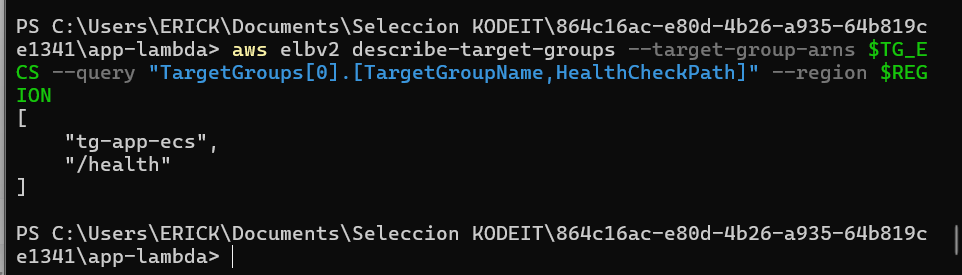

*Evidencia: health check de `tg-app-ecs` configurado en `/health`.*

### Resultado al crear el ALB

El balanceador quedó público, con un listener HTTP en el puerto 80. El DNS que me dio AWS es la URL que uso para las pruebas.

**Comando que ejecuté:**

```powershell
echo $TG_ECS
echo $ALB_DNS
echo $LISTENER
```

**Salida de mi consola:**

```text
PS C:\Users\ERICK> echo $TG_ECS
arn:aws:elasticloadbalancing:us-east-1:<ID_CUENTA>:targetgroup/tg-app-ecs/91114d6b921f5594
PS C:\Users\ERICK> echo $ALB_DNS
alb-examen-1242050974.us-east-1.elb.amazonaws.com
PS C:\Users\ERICK> echo $LISTENER
arn:aws:elasticloadbalancing:us-east-1:<ID_CUENTA>:listener/app/alb-examen/4e56aa3f49a7ba75/1d4fded4d1231ba2
```

## 7. Tarea y servicio ECS Fargate

La definición de tarea usa 256 CPU units, 512 MiB, una instancia del contenedor `app-ecs`, el puerto 3000 y la variable `APP_ENV=qa`. Los logs de `stdout` llegan a CloudWatch con el driver `awslogs`.

```powershell
@"
{
  "family": "app-ecs",
  "networkMode": "awsvpc",
  "requiresCompatibilities": ["FARGATE"],
  "cpu": "256",
  "memory": "512",
  "executionRoleArn": "arn:aws:iam::${ACCOUNT}:role/ecsTaskExecutionRole",
  "containerDefinitions": [{
    "name": "app-ecs",
    "image": "${ECR}/app-ecs:inicial",
    "essential": true,
    "portMappings": [{"containerPort": 3000, "protocol": "tcp"}],
    "environment": [
      {"name": "APP_ENV", "value": "qa"},
      {"name": "PORT", "value": "3000"}
    ],
    "logConfiguration": {
      "logDriver": "awslogs",
      "options": {
        "awslogs-group": "/ecs/app-ecs",
        "awslogs-region": "${REGION}",
        "awslogs-stream-prefix": "ecs"
      }
    }
  }]
}
"@ | Set-Content -Encoding ascii taskdef.json

aws ecs register-task-definition --cli-input-json file://taskdef.json --region $REGION
```

Después creé el servicio con una tarea y lo conecté al target group. Usa las dos subredes y el grupo de seguridad de ECS:

```powershell
aws ecs create-service `
  --cluster app-ecs-cluster --service-name app-ecs-service `
  --task-definition app-ecs --desired-count 1 --launch-type FARGATE `
  --network-configuration "awsvpcConfiguration={subnets=[$S1,$S2],securityGroups=[$SG_ECS],assignPublicIp=ENABLED}" `
  --load-balancers "targetGroupArn=$TG_ECS,containerName=app-ecs,containerPort=3000" `
  --region $REGION

aws ecs wait services-stable --cluster app-ecs-cluster `
  --services app-ecs-service --region $REGION

aws ecs describe-services --cluster app-ecs-cluster --services app-ecs-service `
  --query 'services[0].[serviceName,status,runningCount,desiredCount]' `
  --output table --region $REGION

aws elbv2 describe-target-health --target-group-arn $TG_ECS `
  --query 'TargetHealthDescriptions[*].TargetHealth.State' --region $REGION

curl.exe "http://$ALB_DNS/health"
```

Lo que espero ver es el servicio `ACTIVE`, una tarea corriendo, el target en `healthy` y un JSON con `"service":"app-ecs"`.

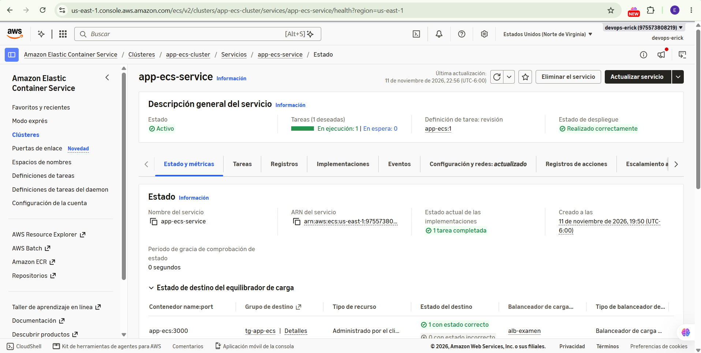

*Evidencia: servicio ECS con una tarea en ejecución.*

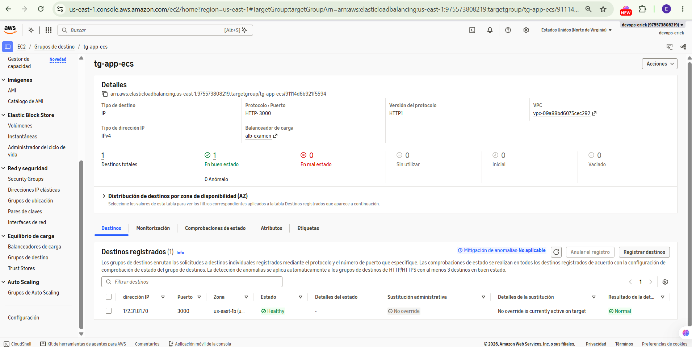

*Evidencia: target group de ECS con destinos registrados y health checks.*

### Problema del 503, servicio y health check

En mi primera prueba el ALB devolvió `503` porque todavía no había tareas ECS sanas registradas. Creé el servicio y esperé. Cuando volví a correr el comando de creación me salió un error de idempotencia, porque el servicio ya existía; en ese momento solo había que consultarlo, no crearlo otra vez.

**Comando que ejecuté:**

```powershell
curl.exe http://$ALB_DNS/api/clientes
aws ecs describe-services --cluster app-ecs-cluster --services app-ecs-service --region $REGION --query "{servicios:services[*].[serviceName,status,runningCount,desiredCount],fallas:failures}"
curl.exe -i http://$ALB_DNS/health
```

**Salida de mi consola:**

```text
# Primer intento:
PS C:\Users\ERICK> curl.exe http://$ALB_DNS/api/clientes
<html><head><title>503 Service Temporarily Unavailable</title></head>
<body><center><h1>503 Service Temporarily Unavailable</h1></center></body></html>

# Al volver a ejecutar create-service sobre un servicio ya creado:
aws: [ERROR]: An error occurred (InvalidParameterException) when calling the CreateService operation:
Creation of service was not idempotent.

# Después de estabilizar ECS:
PS C:\Users\ERICK> curl.exe -i http://$ALB_DNS/health
HTTP/1.1 200 OK
Content-Type: application/json; charset=utf-8
x-build-id: 5230ec53

{"status":"ok","service":"app-ecs","version":"1.0.0","build":"5230ec53","env":"dev"}
```

Ojo con el `"env":"dev"` de esta salida: es de esta primera prueba. La verificación final, con `env: qa`, está en la sección 14.

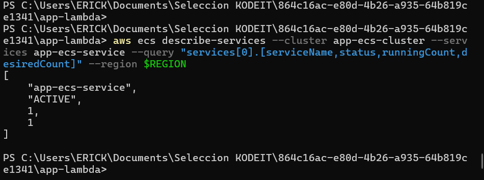

## 8. Función Lambda

Dejé la lógica de pedidos y reportes en `app-lambda/app.mjs`. El archivo `app-lambda/index.mjs` es el adaptador para el ALB y exporta el handler `index.handler`; lo único que hace es agregar la descripción de estado al resultado, por ejemplo `200 OK`. Con eso se arregló el error 502 de las primeras pruebas sin tocar la lógica.

Primero creé un rol que permite escribir logs:

```powershell
@'
{"Version":"2012-10-17","Statement":[{"Effect":"Allow","Principal":{"Service":"lambda.amazonaws.com"},"Action":"sts:AssumeRole"}]}
'@ | Set-Content -Encoding ascii trust-lambda.json

aws iam create-role --role-name lambda-app-role `
  --assume-role-policy-document file://trust-lambda.json

aws iam attach-role-policy --role-name lambda-app-role `
  --policy-arn arn:aws:iam::aws:policy/service-role/AWSLambdaBasicExecutionRole
```

Comprimí los archivos de dentro de `app-lambda`, no la carpeta, para que `index.mjs` quede en la raíz del ZIP:

```powershell
Compress-Archive -Path '.\app-lambda\*' -DestinationPath '.\function.zip' -Force

Start-Sleep -Seconds 15
aws lambda create-function --function-name app-lambda `
  --runtime nodejs24.x --handler index.handler `
  --role "arn:aws:iam::${ACCOUNT}:role/lambda-app-role" `
  --zip-file fileb://function.zip `
  --environment 'Variables={APP_ENV=qa}' --region $REGION

aws lambda wait function-active --function-name app-lambda --region $REGION
```

La pausa de 15 segundos es porque IAM tarda un poco en propagar el rol nuevo. Usé el runtime Node.js 24.

### Conectar Lambda al mismo ALB

Para Lambda creé otro target group, de tipo `lambda`. El permiso `alb-invoke` hace que solo ese target group pueda invocar la función.

```powershell
$LAMBDA_ARN = aws lambda get-function --function-name app-lambda `
  --query 'Configuration.FunctionArn' --output text --region $REGION

$TG_LAMBDA = aws elbv2 create-target-group `
  --name tg-app-lambda --target-type lambda `
  --query 'TargetGroups[0].TargetGroupArn' --output text --region $REGION

aws lambda add-permission --function-name app-lambda --statement-id alb-invoke `
  --action lambda:InvokeFunction --principal elasticloadbalancing.amazonaws.com `
  --source-arn $TG_LAMBDA --region $REGION

aws elbv2 register-targets --target-group-arn $TG_LAMBDA `
  --targets "Id=$LAMBDA_ARN" --region $REGION
```

Agregué las dos reglas que faltaban. Pedidos y reportes van a Lambda, y el `/health` de Lambda se identifica con un `Host` específico:

```powershell
aws elbv2 create-rule --listener-arn $LISTENER --priority 20 `
  --conditions 'Field=path-pattern,Values=/api/pedidos*,/api/reportes*' `
  --actions "Type=forward,TargetGroupArn=$TG_LAMBDA" --region $REGION

aws elbv2 create-rule --listener-arn $LISTENER --priority 25 `
  --conditions 'Field=path-pattern,Values=/health' 'Field=host-header,Values=lambda.examen.local' `
  --actions "Type=forward,TargetGroupArn=$TG_LAMBDA" --region $REGION

curl.exe "http://$ALB_DNS/api/pedidos"
curl.exe "http://$ALB_DNS/api/reportes"
curl.exe -H 'Host: lambda.examen.local' "http://$ALB_DNS/health"
```

`lambda.examen.local` no es un dominio real; es solo el valor del encabezado que uso para separar el `/health` de los dos servicios.

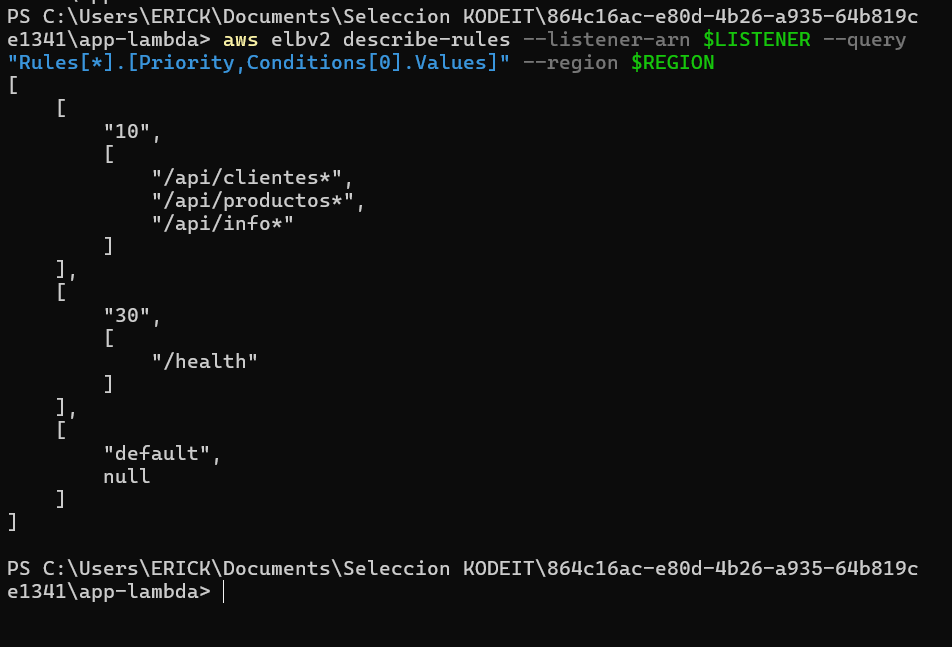

*Evidencia: reglas de enrutamiento del listener del ALB.*

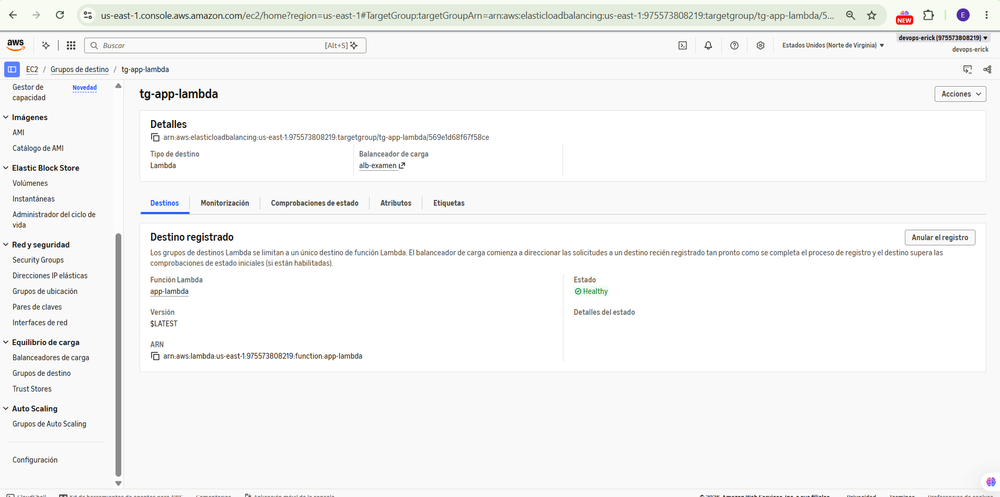

*Evidencia: Lambda registrada como destino del balanceador.*

### Resultado de Lambda y cómo corregí el 502

Creé la función y la asocié a `tg-app-lambda`. Al invocarla directo respondía 200, pero a través del ALB salía `502 Bad Gateway`. Revisé la salida y vi que mandaba `statusDescription: "200"` en lugar de `"200 OK"`. Por eso separé la lógica en `app.mjs` y agregué `index.mjs`, que arma la descripción HTTP completa. Después de subir el ZIP nuevo, el target pasó a `healthy` y el ALB devolvió 200.

**Comando que ejecuté:**

```powershell
aws lambda invoke --function-name app-lambda --payload fileb://evento.json --region $REGION salida.json
Get-Content salida.json
aws elbv2 describe-target-health --target-group-arn $TG_LAMBDA --query "TargetHealthDescriptions[0].TargetHealth.State" --output text --region $REGION
curl.exe -i "http://$ALB_DNS/api/pedidos"
```

**Salida de mi consola:**

```text
# La invocación directa terminaba sin error:
PS C:\Users\ERICK> aws lambda invoke --function-name app-lambda --payload fileb://evento.json --region $REGION salida.json
{
    "StatusCode": 200,
    "ExecutedVersion": "$LATEST"
}
PS C:\Users\ERICK> Get-Content salida.json
{"statusCode":200,"statusDescription":"200","isBase64Encoded":false,...}

# Pero el ALB devolvía esto:
PS C:\Users\ERICK> curl.exe http://$ALB_DNS/api/pedidos
<html><head><title>502 Bad Gateway</title></head>
<body><center><h1>502 Bad Gateway</h1></center></body></html>

# El target dio la causa:
"State": "unhealthy"
"Reason": "Target.FailedHealthChecks"
"Description": "The response from the Lambda function is not in the expected format"

# Después del adaptador y del nuevo despliegue:
PS C:\Users\ERICK> curl.exe -i http://$ALB_DNS/api/pedidos
HTTP/1.1 200 OK
Server: awselb/2.0
x-build-id: 5230ec53
```

## 9. Bucket de artefactos y conexión con GitHub

CodePipeline usa S3 para pasar el código y los artefactos entre Source, Build y Deploy.

```powershell
aws s3 mb "s3://$BUCKET" --region $REGION
```

Luego creé la conexión de AWS con GitHub desde la consola:

1. AWS → Developer Tools → Connections → Create connection, con proveedor GitHub.
2. Autoricé la aplicación AWS Connector for GitHub en la cuenta `erickvb92`, con permiso para el repositorio `devops-aws`.
3. Confirmé que la conexión apareciera como **Available**. En estado Pending no sirve.

Consulté el ARN de la conexión y lo guardé en `$CONN`:

```powershell
aws codeconnections list-connections --provider-type GitHub `
  --query 'Connections[*].[ConnectionName,ConnectionArn,ConnectionStatus]' `
  --output table --region $REGION

# Pegar aquí el ARN real que apareció en el comando anterior:
$CONN = 'ARN_REAL_DE_TU_CONEXION'
```

El ARN es distinto en cada cuenta, por eso no dejé uno fijo. En la cuenta del examen la conexión ya está autorizada y los pipelines usan el repositorio `erickvb92/devops-aws`.

### Resultado al crear el bucket

**Comando que ejecuté:**

```powershell
$BUCKET = "pipeline-artifacts-$ACCOUNT-$REGION"
aws s3 mb "s3://$BUCKET" --region $REGION
```

**Salida de mi consola:**

```text
PS C:\Users\ERICK> aws s3 mb s3://$BUCKET --region $REGION
make_bucket: pipeline-artifacts-<ID_CUENTA>-us-east-1
```

## 10. CodeBuild para ECS

CodeBuild necesita modo privilegiado para construir imágenes Docker. Creé su rol IAM con acceso al grupo de logs, al repositorio ECR y al bucket de artefactos.

```powershell
@'
{"Version":"2012-10-17","Statement":[{"Effect":"Allow","Principal":{"Service":"codebuild.amazonaws.com"},"Action":"sts:AssumeRole"}]}
'@ | Set-Content -Encoding ascii trust-codebuild.json

aws iam create-role --role-name codebuild-app-ecs-role `
  --assume-role-policy-document file://trust-codebuild.json

@"
{
  "Version": "2012-10-17",
  "Statement": [
    {"Effect":"Allow","Action":["logs:CreateLogGroup","logs:CreateLogStream","logs:PutLogEvents"],
     "Resource":["arn:aws:logs:${REGION}:${ACCOUNT}:log-group:/aws/codebuild/build-app-ecs","arn:aws:logs:${REGION}:${ACCOUNT}:log-group:/aws/codebuild/build-app-ecs:*"]},
    {"Effect":"Allow","Action":"ecr:GetAuthorizationToken","Resource":"*"},
    {"Effect":"Allow","Action":["ecr:BatchCheckLayerAvailability","ecr:InitiateLayerUpload","ecr:UploadLayerPart","ecr:CompleteLayerUpload","ecr:PutImage","ecr:BatchGetImage","ecr:GetDownloadUrlForLayer"],
     "Resource":"arn:aws:ecr:${REGION}:${ACCOUNT}:repository/app-ecs"},
    {"Effect":"Allow","Action":["s3:GetObject","s3:GetObjectVersion","s3:PutObject","s3:GetBucketLocation"],
     "Resource":["arn:aws:s3:::${BUCKET}","arn:aws:s3:::${BUCKET}/*"]}
  ]
}
"@ | Set-Content -Encoding ascii codebuild-ecs-policy.json

aws iam put-role-policy --role-name codebuild-app-ecs-role `
  --policy-name codebuild-app-ecs-policy `
  --policy-document file://codebuild-ecs-policy.json
```

El proyecto usa el `buildspec.yml` que ya está en el repositorio, no uno escrito a mano en AWS:

```powershell
@"
{
  "name":"build-app-ecs",
  "source":{"type":"CODEPIPELINE","buildspec":"app-ecs/buildspec.yml"},
  "artifacts":{"type":"CODEPIPELINE"},
  "environment":{
    "type":"LINUX_CONTAINER",
    "image":"aws/codebuild/amazonlinux-x86_64-standard:5.0",
    "computeType":"BUILD_GENERAL1_SMALL",
    "privilegedMode":true,
    "environmentVariables":[
      {"name":"ECR_URI","value":"${ECR}","type":"PLAINTEXT"},
      {"name":"AWS_REGION","value":"${REGION}","type":"PLAINTEXT"}
    ]
  },
  "serviceRole":"arn:aws:iam::${ACCOUNT}:role/codebuild-app-ecs-role",
  "logsConfig":{"cloudWatchLogs":{"status":"ENABLED","groupName":"/aws/codebuild/build-app-ecs"}}
}
"@ | Set-Content -Encoding ascii codebuild-ecs.json

aws codebuild create-project --cli-input-json file://codebuild-ecs.json --region $REGION

aws codebuild batch-get-projects --names build-app-ecs `
  --query 'projects[0].[name,environment.privilegedMode,source.buildspec]' `
  --output table --region $REGION
```

Debe aparecer `build-app-ecs`, `True` y `app-ecs/buildspec.yml`.

### Cómo comprobé que CodeBuild quedó bien

En el primer intento CodeBuild no encontraba el buildspec, porque Windows lo había guardado como `buildspec.yml.txt`. Le corregí el nombre a `app-ecs/buildspec.yml`. También me salió un `429 Too Many Requests` al bajar Node desde Docker Hub, así que cambié el Dockerfile para usar la imagen de ECR Public. Al final comprobé que el proyecto estuviera en modo privilegiado y apuntara al buildspec correcto.

**Comando que ejecuté:**

```powershell
aws codebuild batch-get-projects --names build-app-ecs --query "projects[0].[name,environment.privilegedMode,source.buildspec]" --region $REGION
aws ecr describe-images --repository-name app-ecs --query "imageDetails[*].imageTags" --region $REGION
```

**Salida de mi consola:**

```text
PS C:\Users\ERICK> aws codebuild batch-get-projects --names build-app-ecs --query "projects[0].[name,environment.privilegedMode,source.buildspec]" --region $REGION
[
    "build-app-ecs",
    true,
    "app-ecs/buildspec.yml"
]

# Después del build correcto, ECR mostró imágenes nuevas además de la inicial:
PS C:\Users\ERICK> aws ecr describe-images --repository-name app-ecs --query "imageDetails[*].imageTags" --region $REGION
[
    ["abda2a6", "latest"],
    ["inicial"]
]
```

## 11. Pipeline de ECS

Para CodePipeline creé un rol aparte. Puede usar la conexión de GitHub, los artefactos, **su** proyecto de CodeBuild y actualizar **su** servicio ECS, y nada más.

```powershell
@'
{"Version":"2012-10-17","Statement":[{"Effect":"Allow","Principal":{"Service":"codepipeline.amazonaws.com"},"Action":"sts:AssumeRole"}]}
'@ | Set-Content -Encoding ascii trust-pipeline.json

aws iam create-role --role-name codepipeline-app-ecs-role `
  --assume-role-policy-document file://trust-pipeline.json

@"
{
  "Version":"2012-10-17",
  "Statement":[
    {"Effect":"Allow","Action":["codeconnections:UseConnection","codestar-connections:UseConnection"],"Resource":"${CONN}"},
    {"Effect":"Allow","Action":["s3:GetObject","s3:GetObjectVersion","s3:PutObject","s3:GetBucketVersioning","s3:GetBucketLocation"],"Resource":["arn:aws:s3:::${BUCKET}","arn:aws:s3:::${BUCKET}/*"]},
    {"Effect":"Allow","Action":["codebuild:StartBuild","codebuild:BatchGetBuilds"],"Resource":"arn:aws:codebuild:${REGION}:${ACCOUNT}:project/build-app-ecs"},
    {"Effect":"Allow","Action":["ecs:DescribeServices","ecs:UpdateService"],"Resource":"arn:aws:ecs:${REGION}:${ACCOUNT}:service/app-ecs-cluster/app-ecs-service"},
    {"Effect":"Allow","Action":["ecs:RegisterTaskDefinition","ecs:DescribeTaskDefinition","ecs:DescribeTasks","ecs:ListTasks"],"Resource":"*"},
    {"Effect":"Allow","Action":"iam:PassRole","Resource":"arn:aws:iam::${ACCOUNT}:role/ecsTaskExecutionRole","Condition":{"StringEquals":{"iam:PassedToService":"ecs-tasks.amazonaws.com"}}}
  ]
}
"@ | Set-Content -Encoding ascii pipeline-ecs-policy.json

aws iam put-role-policy --role-name codepipeline-app-ecs-role `
  --policy-name codepipeline-app-ecs-policy `
  --policy-document file://pipeline-ecs-policy.json
```

El pipeline tiene tres etapas: Source, Build y Deploy. La rama es `QA` (con mayúsculas) y el filtro solo reacciona a cambios dentro de `app-ecs/**`.

```powershell
@"
{
  "pipeline":{
    "name":"pipeline-app-ecs",
    "pipelineType":"V2",
    "roleArn":"arn:aws:iam::${ACCOUNT}:role/codepipeline-app-ecs-role",
    "artifactStore":{"type":"S3","location":"${BUCKET}"},
    "stages":[
      {"name":"Source","actions":[{
        "name":"Source","actionTypeId":{"category":"Source","owner":"AWS","provider":"CodeStarSourceConnection","version":"1"},
        "configuration":{"ConnectionArn":"${CONN}","FullRepositoryId":"${REPO_ID}","BranchName":"QA","OutputArtifactFormat":"CODE_ZIP","DetectChanges":"false"},
        "outputArtifacts":[{"name":"SourceOutput"}]
      }]},
      {"name":"Build","actions":[{
        "name":"Build","actionTypeId":{"category":"Build","owner":"AWS","provider":"CodeBuild","version":"1"},
        "configuration":{"ProjectName":"build-app-ecs"},
        "inputArtifacts":[{"name":"SourceOutput"}],"outputArtifacts":[{"name":"BuildOutput"}]
      }]},
      {"name":"Deploy","actions":[{
        "name":"Deploy","actionTypeId":{"category":"Deploy","owner":"AWS","provider":"ECS","version":"1"},
        "configuration":{"ClusterName":"app-ecs-cluster","ServiceName":"app-ecs-service","FileName":"imagedefinitions.json"},
        "inputArtifacts":[{"name":"BuildOutput"}]
      }]}
    ],
    "triggers":[{"providerType":"CodeStarSourceConnection","gitConfiguration":{
      "sourceActionName":"Source","push":[{"branches":{"includes":["QA"]},"filePaths":{"includes":["app-ecs/**"]}}]
    }}]
  }
}
"@ | Set-Content -Encoding ascii pipeline-ecs.json

aws codepipeline create-pipeline --cli-input-json file://pipeline-ecs.json --region $REGION
```

Para ver el estado de las etapas:

```powershell
aws codepipeline get-pipeline-state --name pipeline-app-ecs `
  --query 'stageStates[*].[stageName,latestExecution.status]' `
  --output table --region $REGION
```

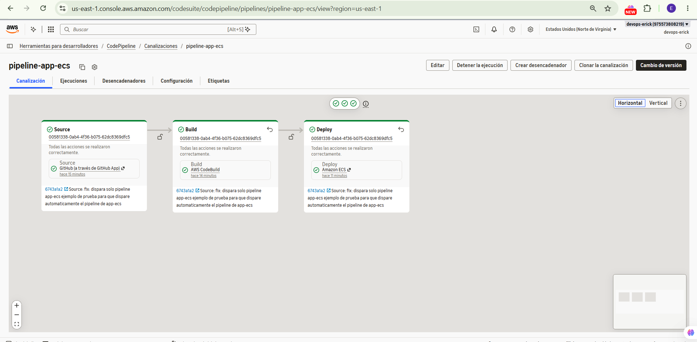

*Evidencia: Source, Build y Deploy completados en el pipeline de ECS.*

### Primer error del pipeline de ECS

Al principio puse la rama `desarrollo` en minúsculas, pero en GitHub se llama `Desarrollo`, así que la etapa Source falló. Lo corregí en `BranchName` y en `triggers`. Más adelante, cuando armé el flujo con Pull Requests, cambié los dos campos a `QA`, que es como quedó la entrega.

**Comando que ejecuté:**

```powershell
aws codepipeline get-pipeline-state --name pipeline-app-ecs --query "stageStates[0].actionStates[0].latestExecution.errorDetails" --region $REGION
aws codepipeline get-pipeline-state --name pipeline-app-ecs --query "stageStates[*].[stageName,latestExecution.status]" --output table --region $REGION
```

**Salida de mi consola:**

```text
# Falla en Source:
PS C:\Users\ERICK> aws codepipeline get-pipeline-state --name pipeline-app-ecs --query "stageStates[0].actionStates[0].latestExecution.errorDetails" --region $REGION
{
    "code": "JobFailed",
    "message": "[GitHub] No Branch [desarrollo] found for FullRepositoryName [erickvb92/devops-aws]"
}

# Configuración final verificada:
PIPELINE: pipeline-app-ecs
"Repositorio": "erickvb92/devops-aws"
"Rama": "QA"
"branches": { "includes": ["QA"] }
"filePaths": { "includes": ["app-ecs/**"] }
```

## 12. Proyectos y pipeline de Lambda

En Lambda usé dos proyectos de CodeBuild: uno genera `function.zip` y el otro lo publica con `aws lambda update-function-code`. Así el pipeline también queda con las tres etapas Source, Build y Deploy.

Este es el `app-lambda/buildspec.yml` que ya estaba en el repositorio:

```yaml
version: 0.2
phases:
  build:
    commands:
      - cd app-lambda
      - zip -r $CODEBUILD_SRC_DIR/function.zip . -x "buildspec.yml" "*.md"
artifacts:
  files:
    - function.zip
```

### 12.1 Rol IAM de CodeBuild para Lambda

```powershell
aws iam create-role --role-name codebuild-app-lambda-role `
  --assume-role-policy-document file://trust-codebuild.json

@"
{
  "Version":"2012-10-17",
  "Statement":[
    {"Effect":"Allow","Action":["logs:CreateLogGroup","logs:CreateLogStream","logs:PutLogEvents"],"Resource":[
      "arn:aws:logs:${REGION}:${ACCOUNT}:log-group:/aws/codebuild/build-app-lambda",
      "arn:aws:logs:${REGION}:${ACCOUNT}:log-group:/aws/codebuild/build-app-lambda:*",
      "arn:aws:logs:${REGION}:${ACCOUNT}:log-group:/aws/codebuild/deploy-app-lambda",
      "arn:aws:logs:${REGION}:${ACCOUNT}:log-group:/aws/codebuild/deploy-app-lambda:*"
    ]},
    {"Effect":"Allow","Action":["s3:GetObject","s3:GetObjectVersion","s3:PutObject","s3:GetBucketLocation"],"Resource":["arn:aws:s3:::${BUCKET}","arn:aws:s3:::${BUCKET}/*"]},
    {"Effect":"Allow","Action":["lambda:UpdateFunctionCode","lambda:GetFunction","lambda:GetFunctionConfiguration"],"Resource":"arn:aws:lambda:${REGION}:${ACCOUNT}:function:app-lambda"}
  ]
}
"@ | Set-Content -Encoding ascii codebuild-lambda-policy.json

aws iam put-role-policy --role-name codebuild-app-lambda-role `
  --policy-name codebuild-app-lambda-policy `
  --policy-document file://codebuild-lambda-policy.json
```

### 12.2 Proyectos de Build y Deploy

El primero usa el buildspec del repositorio. El segundo lleva el buildspec incrustado, con el comando que actualiza Lambda.

```powershell
@"
{
  "name":"build-app-lambda",
  "source":{"type":"CODEPIPELINE","buildspec":"app-lambda/buildspec.yml"},
  "artifacts":{"type":"CODEPIPELINE"},
  "environment":{"type":"LINUX_CONTAINER","image":"aws/codebuild/amazonlinux-x86_64-standard:5.0","computeType":"BUILD_GENERAL1_SMALL","privilegedMode":false},
  "serviceRole":"arn:aws:iam::${ACCOUNT}:role/codebuild-app-lambda-role",
  "logsConfig":{"cloudWatchLogs":{"status":"ENABLED","groupName":"/aws/codebuild/build-app-lambda"}}
}
"@ | Set-Content -Encoding ascii codebuild-lambda-build.json

@"
{
  "name":"deploy-app-lambda",
  "source":{"type":"CODEPIPELINE","buildspec":"version: 0.2\nphases:\n  build:\n    commands:\n      - aws lambda update-function-code --function-name app-lambda --zip-file fileb://function.zip\n      - aws lambda wait function-updated --function-name app-lambda"},
  "artifacts":{"type":"CODEPIPELINE"},
  "environment":{"type":"LINUX_CONTAINER","image":"aws/codebuild/amazonlinux-x86_64-standard:5.0","computeType":"BUILD_GENERAL1_SMALL","privilegedMode":false},
  "serviceRole":"arn:aws:iam::${ACCOUNT}:role/codebuild-app-lambda-role",
  "logsConfig":{"cloudWatchLogs":{"status":"ENABLED","groupName":"/aws/codebuild/deploy-app-lambda"}}
}
"@ | Set-Content -Encoding ascii codebuild-lambda-deploy.json

aws codebuild create-project --cli-input-json file://codebuild-lambda-build.json --region $REGION
aws codebuild create-project --cli-input-json file://codebuild-lambda-deploy.json --region $REGION

aws codebuild batch-get-projects --names build-app-lambda deploy-app-lambda `
  --query 'projects[*].[name,source.buildspec]' --region $REGION
```

### 12.3 Pipeline de Lambda

```powershell
aws iam create-role --role-name codepipeline-app-lambda-role `
  --assume-role-policy-document file://trust-pipeline.json

@"
{
  "Version":"2012-10-17",
  "Statement":[
    {"Effect":"Allow","Action":["codeconnections:UseConnection","codestar-connections:UseConnection"],"Resource":"${CONN}"},
    {"Effect":"Allow","Action":["s3:GetObject","s3:GetObjectVersion","s3:PutObject","s3:GetBucketVersioning","s3:GetBucketLocation"],"Resource":["arn:aws:s3:::${BUCKET}","arn:aws:s3:::${BUCKET}/*"]},
    {"Effect":"Allow","Action":["codebuild:StartBuild","codebuild:BatchGetBuilds"],"Resource":[
      "arn:aws:codebuild:${REGION}:${ACCOUNT}:project/build-app-lambda",
      "arn:aws:codebuild:${REGION}:${ACCOUNT}:project/deploy-app-lambda"
    ]}
  ]
}
"@ | Set-Content -Encoding ascii pipeline-lambda-policy.json

aws iam put-role-policy --role-name codepipeline-app-lambda-role `
  --policy-name codepipeline-app-lambda-policy `
  --policy-document file://pipeline-lambda-policy.json

@"
{
  "pipeline":{
    "name":"pipeline-app-lambda",
    "pipelineType":"V2",
    "roleArn":"arn:aws:iam::${ACCOUNT}:role/codepipeline-app-lambda-role",
    "artifactStore":{"type":"S3","location":"${BUCKET}"},
    "stages":[
      {"name":"Source","actions":[{
        "name":"Source","actionTypeId":{"category":"Source","owner":"AWS","provider":"CodeStarSourceConnection","version":"1"},
        "configuration":{"ConnectionArn":"${CONN}","FullRepositoryId":"${REPO_ID}","BranchName":"QA","OutputArtifactFormat":"CODE_ZIP","DetectChanges":"false"},
        "outputArtifacts":[{"name":"SourceOutput"}]
      }]},
      {"name":"Build","actions":[{
        "name":"Build","actionTypeId":{"category":"Build","owner":"AWS","provider":"CodeBuild","version":"1"},
        "configuration":{"ProjectName":"build-app-lambda"},
        "inputArtifacts":[{"name":"SourceOutput"}],"outputArtifacts":[{"name":"BuildOutput"}]
      }]},
      {"name":"Deploy","actions":[{
        "name":"Deploy","actionTypeId":{"category":"Build","owner":"AWS","provider":"CodeBuild","version":"1"},
        "configuration":{"ProjectName":"deploy-app-lambda"},
        "inputArtifacts":[{"name":"BuildOutput"}]
      }]}
    ],
    "triggers":[{"providerType":"CodeStarSourceConnection","gitConfiguration":{
      "sourceActionName":"Source","push":[{"branches":{"includes":["QA"]},"filePaths":{"includes":["app-lambda/**"]}}]
    }}]
  }
}
"@ | Set-Content -Encoding ascii pipeline-lambda.json

aws codepipeline create-pipeline --cli-input-json file://pipeline-lambda.json --region $REGION
```

Para verificar las tres etapas:

```powershell
aws codepipeline get-pipeline-state --name pipeline-app-lambda `
  --query 'stageStates[*].[stageName,latestExecution.status]' `
  --output table --region $REGION
```

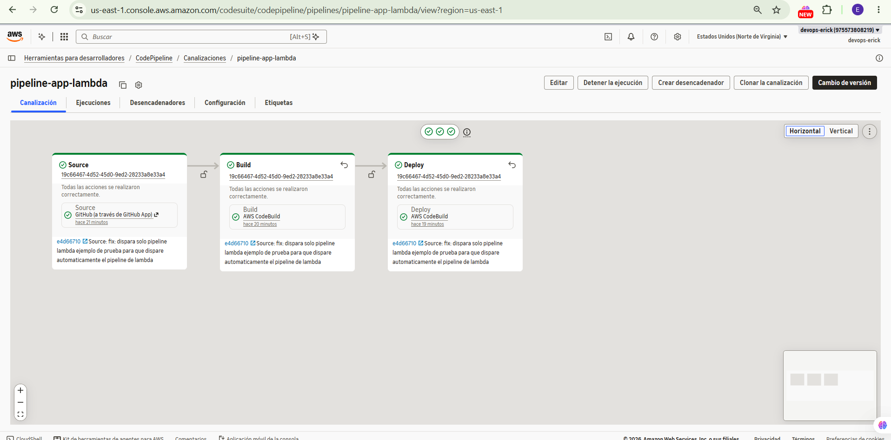

*Evidencia: Source, Build y Deploy completados en el pipeline de Lambda.*

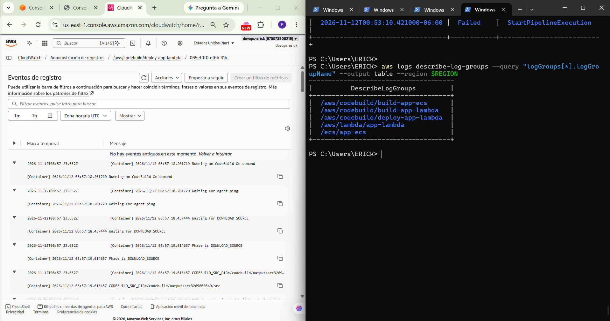

*Evidencia: ejecución de CodeBuild que actualiza Lambda.*

### Resultado del build y del pipeline de Lambda

Dejé dos proyectos: `build-app-lambda`, que genera `function.zip`, y `deploy-app-lambda`, que ejecuta `aws lambda update-function-code`. Comprobé los dos y después vi las tres etapas del pipeline en verde.

**Comando que ejecuté:**

```powershell
aws codebuild batch-get-projects --names build-app-lambda deploy-app-lambda --query "projects[*].[name,source.buildspec]" --region $REGION
aws codepipeline get-pipeline-state --name pipeline-app-lambda --query "stageStates[*].[stageName,latestExecution.status]" --output table --region $REGION
```

**Salida de mi consola:**

```text
PS C:\Users\ERICK> aws codebuild batch-get-projects --names build-app-lambda deploy-app-lambda --query "projects[*].[name,source.buildspec]" --region $REGION
[
    ["build-app-lambda", "app-lambda/buildspec.yml"],
    ["deploy-app-lambda", "version: 0.2\nphases: ... aws lambda update-function-code --function-name app-lambda --zip-file fileb://function.zip ..."]
]

PS C:\Users\ERICK> aws codepipeline get-pipeline-state --name pipeline-app-lambda --query "stageStates[*].[stageName,latestExecution.status]" --output table --region $REGION
-------------------------
|   GetPipelineState    |
+---------+-------------+
|  Source |  Succeeded  |
|  Build  |  Succeeded  |
|  Deploy |  Succeeded  |
+---------+-------------+
```

## 13. Ramas y Pull Requests

Al principio probé el despliegue desde `Desarrollo`, pero al final lo cambié a `QA` para separar mis cambios de trabajo de los despliegues. Así quedó la configuración actual:

```text
Desarrollo   -> hago cambios, commit y push; NO ejecuta pipelines
    |
    | Pull Request y merge
    v
QA           -> CodePipeline detecta los cambios y despliega
```

En GitHub Desktop selecciono `Desarrollo`, hago los cambios y pulso Commit to Desarrollo y Push origin. Cuando quiero liberarlos, abro un Pull Request con base `QA` y compare `Desarrollo`, reviso los cambios y hago merge. Los pipelines se disparan según la carpeta que cambió:

| Cambio integrado en `QA` | Resultado |
|---|---|
| `app-ecs/**` | Ejecuta `pipeline-app-ecs` |
| `app-lambda/**` | Ejecuta `pipeline-app-lambda` |
| Ambas carpetas | Se ejecutan los dos |
| Solo `README.md` o `docs/**` | No se despliega ningún servicio |

Lo probé con cambios reales en QA y los dos pipelines funcionaron.

Para confirmar que la rama y los filtros quedaron guardados en AWS:

```powershell
foreach ($nombre in @('pipeline-app-ecs', 'pipeline-app-lambda')) {
    Write-Host "`nPIPELINE: $nombre"
    aws codepipeline get-pipeline --name $nombre `
      --query 'pipeline.{Repo:stages[0].actions[0].configuration.FullRepositoryId,Branch:stages[0].actions[0].configuration.BranchName,Triggers:triggers}' `
      --region $REGION
}
```

Los dos tienen que mostrar `Branch: QA`; el primero escucha `app-ecs/**` y el segundo `app-lambda/**`. Los nombres `QA` y `Desarrollo` distinguen mayúsculas y minúsculas.

Si se quisiera montar desde cero, primero hay que crear las ramas remotas `Desarrollo` y `QA` y subir el contenido del repositorio, y después crear los pipelines. Al crear un pipeline la primera ejecución puede salir sola; a partir de ahí solo corren los pushes que pasan el filtro.

**Alcance:** implementé y probé el flujo `Desarrollo → QA`. No configuré producción, aprobaciones obligatorias, protección estricta de ramas ni un ambiente AWS independiente para desarrollo. Eso corresponde a la parte opcional del examen.

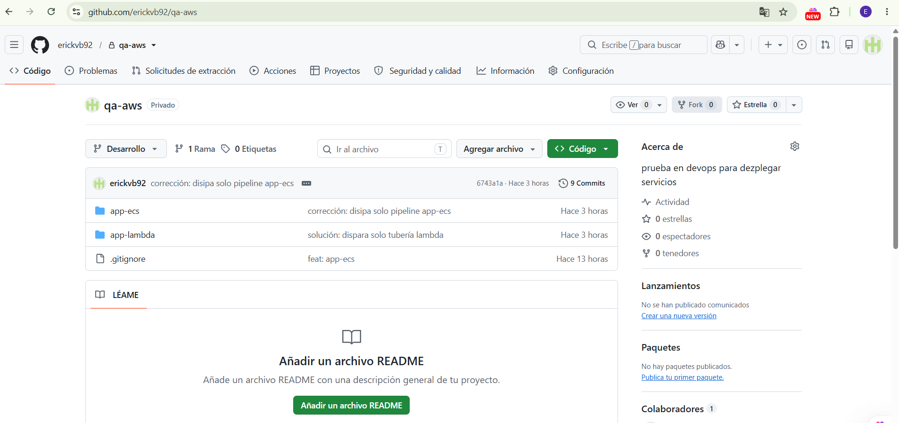

*Evidencia: repositorio con ambas aplicaciones.*

### Comprobación final de la rama que dispara cada pipeline

Terminé trabajando así: hago push a `Desarrollo`, abro un Pull Request hacia `QA` y lo fusiono. Solo entonces AWS lanza un pipeline por cada carpeta modificada. Esta es la verificación de los dos pipelines después de corregir los disparadores.

**Comando que ejecuté:**

```powershell
$REGION = "us-east-1"
foreach ($nombre in @("pipeline-app-ecs", "pipeline-app-lambda")) {
    Write-Host "`nPIPELINE: $nombre"
    aws codepipeline get-pipeline `
      --name $nombre `
      --query "pipeline.{Repositorio:stages[0].actions[0].configuration.FullRepositoryId,Rama:stages[0].actions[0].configuration.BranchName,Triggers:triggers}" `
      --region $REGION
}
```

**Salida de mi consola:**

```text
PIPELINE: pipeline-app-ecs
{
    "Repositorio": "erickvb92/devops-aws",
    "Rama": "QA",
    "Triggers": [{"providerType":"CodeStarSourceConnection","gitConfiguration":{"sourceActionName":"Source","push":[{"branches":{"includes":["QA"]},"filePaths":{"includes":["app-ecs/**"]}}]}}]
}

PIPELINE: pipeline-app-lambda
{
    "Repositorio": "erickvb92/devops-aws",
    "Rama": "QA",
    "Triggers": [{"providerType":"CodeStarSourceConnection","gitConfiguration":{"sourceActionName":"Source","push":[{"branches":{"includes":["QA"]},"filePaths":{"includes":["app-lambda/**"]}}]}}]
}
```

## 14. Validación final por HTTP

La URL pública de la entrega es:

```text
http://alb-examen-1242050974.us-east-1.elb.amazonaws.com
```

A través del ALB probé todas las rutas. Son los mismos comandos con los que comprobé la instalación:

```powershell
$ALB_DNS = 'alb-examen-1242050974.us-east-1.elb.amazonaws.com'

# Health checks de cada servicio
curl.exe -i "http://$ALB_DNS/health"
curl.exe -i -H 'Host: lambda.examen.local' "http://$ALB_DNS/health"

# ECS
curl.exe -i "http://$ALB_DNS/api/clientes"
curl.exe -i "http://$ALB_DNS/api/clientes/1"
curl.exe -i "http://$ALB_DNS/api/productos"
curl.exe -i "http://$ALB_DNS/api/productos/1"
curl.exe -i "http://$ALB_DNS/api/info"

# Lambda
curl.exe -i "http://$ALB_DNS/api/pedidos"
curl.exe -i "http://$ALB_DNS/api/pedidos/1001"
curl.exe -i "http://$ALB_DNS/api/reportes"
curl.exe -i "http://$ALB_DNS/api/reportes/ventas-diarias"
```

Todas respondieron `HTTP 200 OK`. En concreto:

| Ruta | Servicio | Resultado |
|---|---|---|
| `/health` | ECS | `service: app-ecs`, `env: qa` |
| `/health` con `Host: lambda.examen.local` | Lambda | `service: app-lambda`, `env: qa` |
| `/api/clientes/1` | ECS | Ana López |
| `/api/productos/1` | ECS | Teclado, precio 450 |
| `/api/pedidos/1001` | Lambda | Pedido 1001, ENTREGADO |
| `/api/reportes/ventas-diarias` | Lambda | Reporte de ventas diarias |

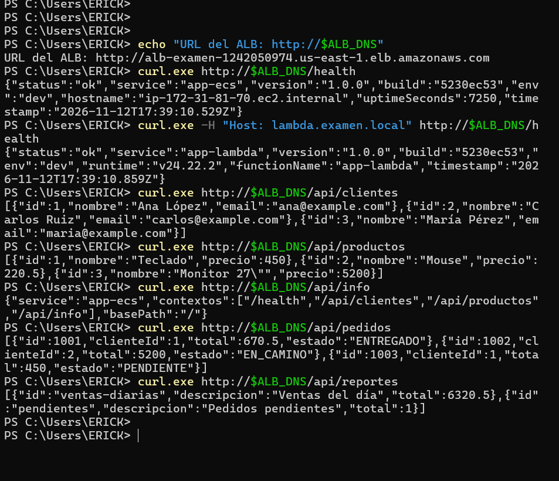

*Evidencia: solicitudes HTTP a ECS y Lambda desde PowerShell.*

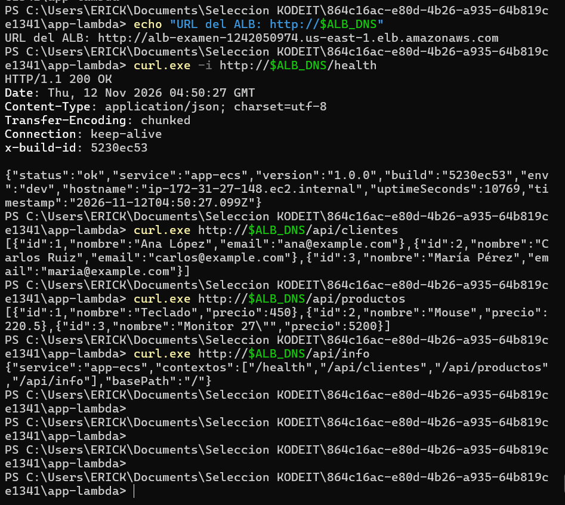

*Evidencia: respuestas de clientes y productos.*

### Respuestas con identificadores

Probé desde mi equipo Windows las rutas con parámetros de los dos servicios. Las cuatro devolvieron HTTP 200 y un JSON con los valores esperados.

**Comando que ejecuté:**

```powershell
$ALB_DNS = "alb-examen-1242050974.us-east-1.elb.amazonaws.com"
curl.exe -i "http://$ALB_DNS/api/clientes/1"
curl.exe -i "http://$ALB_DNS/api/productos/1"
curl.exe -i "http://$ALB_DNS/api/pedidos/1001"
curl.exe -i "http://$ALB_DNS/api/reportes/ventas-diarias"
```

**Salida de mi consola:**

```text
PS C:\Users\ERICK> curl.exe -i "http://$ALB_DNS/api/clientes/1"
HTTP/1.1 200 OK
{"id":1,"nombre":"Ana López","email":"ana@example.com"}

PS C:\Users\ERICK> curl.exe -i "http://$ALB_DNS/api/productos/1"
HTTP/1.1 200 OK
{"id":1,"nombre":"Teclado","precio":450}

PS C:\Users\ERICK> curl.exe -i "http://$ALB_DNS/api/pedidos/1001"
HTTP/1.1 200 OK
Server: awselb/2.0
{"id":1001,"clienteId":1,"total":670.5,"estado":"ENTREGADO"}

PS C:\Users\ERICK> curl.exe -i "http://$ALB_DNS/api/reportes/ventas-diarias"
HTTP/1.1 200 OK
Server: awselb/2.0
{"id":"ventas-diarias","descripcion":"Ventas del día","total":6320.5}
```

### Que ECS y los dos target groups estén saludables

En una sesión nueva de PowerShell recupero los ARN así, sin tener que acordarme de ellos:

```powershell
$REGION = 'us-east-1'
$TG_ECS = aws elbv2 describe-target-groups --names tg-app-ecs `
  --query 'TargetGroups[0].TargetGroupArn' --output text --region $REGION
$TG_LAMBDA = aws elbv2 describe-target-groups --names tg-app-lambda `
  --query 'TargetGroups[0].TargetGroupArn' --output text --region $REGION

aws ecs describe-services --cluster app-ecs-cluster --services app-ecs-service `
  --query 'services[0].[serviceName,status,runningCount,desiredCount]' `
  --output table --region $REGION

aws elbv2 describe-target-health --target-group-arn $TG_ECS `
  --query 'TargetHealthDescriptions[*].[Target.Id,TargetHealth.State]' `
  --output table --region $REGION

aws elbv2 describe-target-health --target-group-arn $TG_LAMBDA `
  --query 'TargetHealthDescriptions[*].[Target.Id,TargetHealth.State]' `
  --output table --region $REGION
```

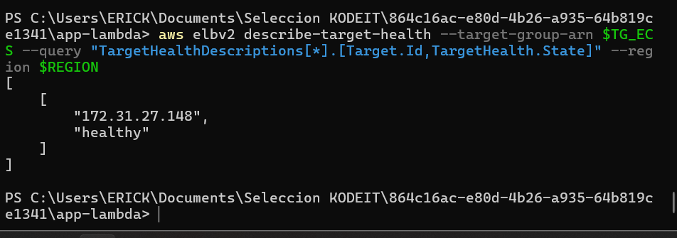

*Evidencia: `tg-app-ecs` con estado `healthy`.*

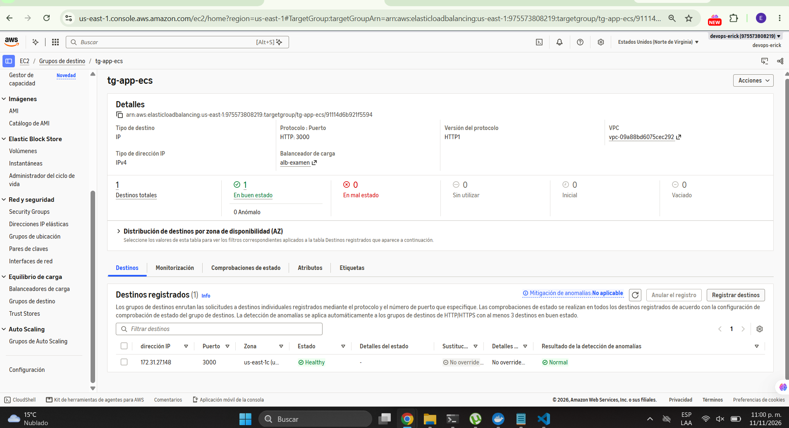

*Evidencia: `tg-app-lambda` con estado `healthy`.*

## 15. Logs en CloudWatch

Estos son los grupos de logs que quedaron:

| Servicio | Grupo |
|---|---|
| Contenedor ECS | `/ecs/app-ecs` |
| Build ECS | `/aws/codebuild/build-app-ecs` |
| Build Lambda | `/aws/codebuild/build-app-lambda` |
| Deploy Lambda | `/aws/codebuild/deploy-app-lambda` |
| Ejecución Lambda | `/aws/lambda/app-lambda` |

```powershell
aws logs describe-log-groups --log-group-name-prefix '/ecs/app-ecs' --region $REGION
aws logs tail '/ecs/app-ecs' --since 10m --region $REGION
aws logs tail '/aws/codebuild/build-app-ecs' --since 1h --region $REGION
aws logs tail '/aws/codebuild/deploy-app-lambda' --since 1h --region $REGION
aws logs tail '/aws/lambda/app-lambda' --since 1h --region $REGION
```

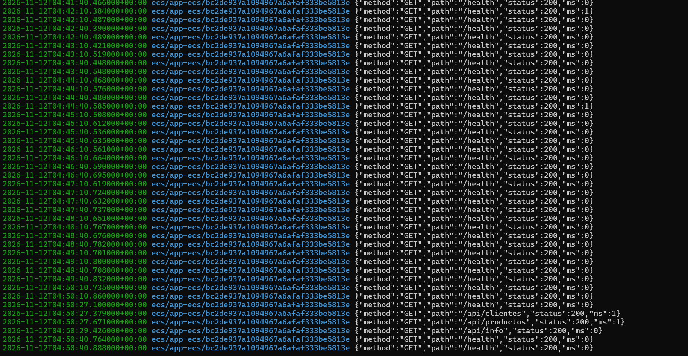

*Evidencia: logs de peticiones de la aplicación ECS en CloudWatch.*

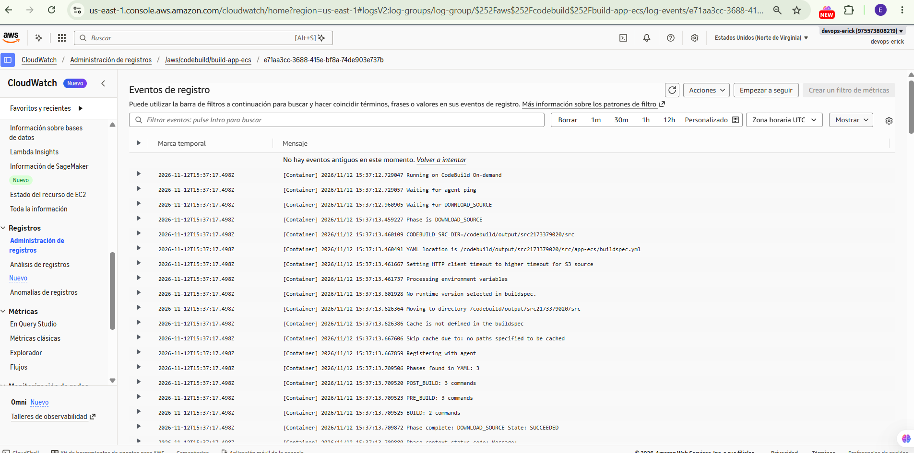

*Evidencia: registros de compilación en CloudWatch.*

## C URL pública del ALB

**http://alb-examen-1242050974.us-east-1.elb.amazonaws.com**

Todos los siguientes endpoints tienen la URL completa para abrirlos directamente en el navegador.
1. ECS Fargate — Clientes y productos
Health Check (ECS)

http://alb-examen-1242050974.us-east-1.elb.amazonaws.com/health

Clientes

http://alb-examen-1242050974.us-east-1.elb.amazonaws.com/api/clientes

Productos

http://alb-examen-1242050974.us-east-1.elb.amazonaws.com/api/productos
2. AWS Lambda — Pedidos y reportes
Pedidos

http://alb-examen-1242050974.us-east-1.elb.amazonaws.com/api/pedidos

Reportes

http://alb-examen-1242050974.us-east-1.elb.amazonaws.com/api/reportes
3. Endpoints adicionales
Cliente por ID

http://alb-examen-1242050974.us-east-1.elb.amazonaws.com/api/clientes/1

Producto por ID

http://alb-examen-1242050974.us-east-1.elb.amazonaws.com/api/productos/1

Información general

http://alb-examen-1242050974.us-east-1.elb.amazonaws.com/api/info

Pedido por ID

http://alb-examen-1242050974.us-east-1.elb.amazonaws.com/api/pedidos/1001

Reporte de ventas diarias

http://alb-examen-1242050974.us-east-1.elb.amazonaws.com/api/reportes/ventas-diarias
4. Health Check de Lambda
La ruta también es:

http://alb-examen-1242050974.us-east-1.elb.amazonaws.com/health

Nota: para que /health llegue a Lambda se debe enviar el encabezado HTTP Host: lambda.examen.local. Si se abre la URL directamente en el navegador, normalmente llegará a ECS porque el navegador enviará el dominio del ALB como Host.

## D. Errores que tuve en el camino

Estos son los errores que me salieron durante el examen y cómo los resolví. El resto de los comandos y respuestas, tal como salieron en la consola y sin credenciales, están en el [registro de PowerShell](docs/logs/consola-powershell-redactada.txt) y en las [notas de la instalación](docs/logs/notas-aws-redactadas.txt).

**1. Security Group con nombre inválido.** AWS no deja nombres que empiecen con `sg-`.

```powershell
PS C:\Users\ERICK> aws ec2 create-security-group --group-name sg-ecs --description "Tareas ECS" --vpc-id $VPC --query GroupId --output text --region $REGION
aws: [ERROR]: An error occurred (InvalidParameterValue) when calling the CreateSecurityGroup operation:
Value (sg-ecs) for parameter GroupName is invalid. Group names may not be in the format sg-*.
```

Los renombré a `alb-publico` y `ecs-tareas`, y después `echo $SG_ALB $SG_ECS` mostró los dos IDs.

**2. El ALB devolvía 503.** No era un error de Node.js: todavía no había una tarea sana registrada en el target group. Lo confirmé con `describe-target-health` y esperé a que el servicio quedara activo.

```powershell
PS C:\Users\ERICK> curl.exe http://$ALB_DNS/api/clientes
<html>
<head><title>503 Service Temporarily Unavailable</title></head>
<body><center><h1>503 Service Temporarily Unavailable</h1></center></body>
</html>
```

**3. Lambda daba 502 en el ALB aunque internamente respondía 200.** El health check lo dejó claro:

```text
"State": "unhealthy",
"Reason": "Target.FailedHealthChecks",
"Description": "The response from the Lambda function is not in the expected format"
```

En la primera versión devolvía `statusDescription: "200"`. Cambié el adaptador para que genere `"200 OK"` y subí un ZIP nuevo. Después el target pasó a `healthy` y las respuestas fueron 200.

**4. Source de CodePipeline falló por las mayúsculas.**

```text
"code": "JobFailed",
"message": "[GitHub] No Branch [desarrollo] found for FullRepositoryName [erickvb92/devops-aws]"
```

La rama se llamaba `Desarrollo`. Corregí el nombre y más tarde hice el ajuste final para que los dos pipelines escucharan `QA`.

**5. CodeBuild no encontraba el `buildspec.yml`.** Sin darme cuenta lo había guardado como `.txt`. Al corregir la extensión, CodeBuild encontró `app-ecs/buildspec.yml`.

**6. Error 429 de Docker Hub.** El contenedor Node se bajaba de Docker Hub y CodeBuild recibió `429 Too Many Requests`. Lo resolví cambiando la imagen base en `app-ecs/Dockerfile`:

```dockerfile
FROM public.ecr.aws/docker/library/node:24-alpine
```

**7. Errores que no eran de AWS.** En alguna prueba pegué en PowerShell texto explicativo (`sg-alb deja entrar...`) o líneas de salida de la terminal como si fueran comandos, y PowerShell devolvió `CommandNotFoundException` o errores de sintaxis. Lo arreglé ejecutando solo los bloques de comandos.

## E. Cómo liberaría a Desarrollo, QA y Producción

En un proyecto real usaría tres ambientes separados, para que una prueba nunca afecte a producción.

**Desarrollo.** Cada programador trabaja en una rama `feature/*` creada desde `Desarrollo`. Abre un Pull Request, se revisa el código y se corren pruebas. Al aprobarlo se integra a `Desarrollo` y se despliega solo a un ambiente DEV con `APP_ENV=dev`.

**QA.** Cuando una versión está lista, se abre un PR de `Desarrollo` hacia `QA`. Aquí pediría, además de la revisión del código, que las pruebas pasen, que el equipo de QA valide y que apruebe al menos una persona distinta del autor. Al hacer merge, CodePipeline despliega al ambiente de pruebas con `APP_ENV=qa`. Este es el único paso que alcancé a conectar con AWS: no me dio tiempo de montar los ambientes por separado, y por eso el despliegue quedó solo en QA.

**Producción.** Después de las pruebas funcionales y de regresión, se abre un PR de `QA` hacia `prod` (o `main`, según lo que use el equipo). Protegería esa rama contra pushes directos y pediría aprobaciones, pruebas exitosas y una aprobación manual antes de liberar. Tendría su propio pipeline y sus propios recursos, con `APP_ENV=prod`, monitoreo y forma de revertir.

Protegería las ramas principales contra borrado y cambios directos, y pondría validaciones automáticas en cada PR.

En esta entrega solo configuré y probé el flujo `Desarrollo → QA` sobre un ambiente de AWS, por falta de tiempo.

**Repositorio:** https://github.com/erickvb92/devops-aws

**URL pública:** http://alb-examen-1242050974.us-east-1.elb.amazonaws.com